# 02516 Introduction to Deep Learning in Computer Vision (DTU)

Coursework in PyTorch: exercises, two projects, and the notes I wrote along the way.
This README is a map of **what I learned and what I can now do**. Every figure below comes from my own notebooks, except where marked *team*.

## At a glance

| Part | What I learned | Headline result |
|---|---|---|
| **Week 1**: MNIST & CIFAR-10 | Fully connected nets, CNN arithmetic, augmentation, dropout, BatchNorm, residual blocks, optimizers | MNIST CNN 98.8% · CIFAR-10 CNN 72.2% |
| **Week 2**: GPU on HPC | Running PyTorch as a batch job on the DTU LSF cluster | Scripts written (no saved job output) |
| **Project 1**: Hotdog / not-hotdog | Baseline → resizing → BatchNorm → transfer learning, and reading training curves honestly | From-scratch CNN 74% → fine-tuned ResNet-18 **90.8%** |
| **Project 2**: Video action classification | Where to combine time in a video model: per-frame, late fusion, early fusion, 3D CNN, two-stream | Dual-stream (RGB + optical flow) **77.5%** test, leakage-free split |

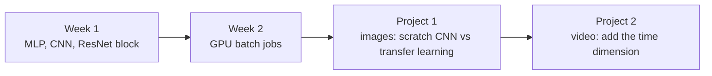

---

## Week 1: Neural networks and CNNs for image classification

**Notebooks:** `IDLCV_Exercise_1_1_NNs.ipynb`, `IDLCV_Exercise_1_2_CNNs.ipynb`, `IDLCV_Exercise_1_3_CIFAR_Classification.ipynb`

### What I learned
- **MNIST with a fully connected net.** Moving from 100 hidden units to 2×256 units, with a higher learning rate, took test accuracy from 96.4% to 97.8%.
- **Reading a prediction, not just an accuracy.** I plotted each prediction with its confidence and, for mistakes, the second-choice class.

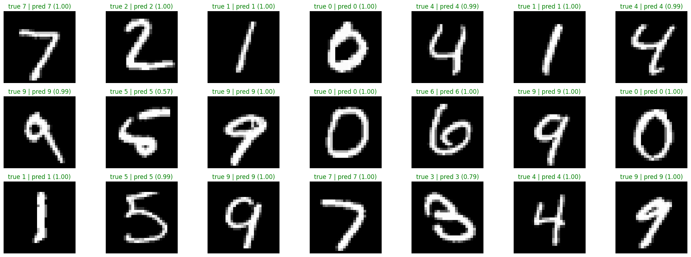

- **CNN size arithmetic.** Output size is `floor((N + 2·padding − kernel) / stride) + 1`. I picked padding and stride so a 4-layer CNN kept its feature-map size, reaching **98.8%** on MNIST.
- **Augmentation and dropout.** Random rotation keeps the label while changing the pixels. In my runs rotation gave 98.5% and dropout 98.6%. Those differences are too small to show an effect from one run.

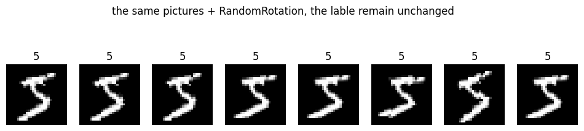

- **What a CNN actually learns.** I visualized the 8 first-layer 3×3 filters. They are small edge and blob detectors.

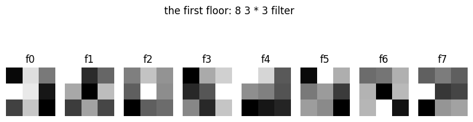

- **Why first-epoch test accuracy can beat training accuracy.** Training accuracy is averaged *during* the epoch while the weights are still improving. Test accuracy is measured at the end.
- **CIFAR-10 with BatchNorm, Kaiming init and Adam.** Final test accuracy 72.2% (peak 74.0%). The widening gap between the two curves is overfitting.

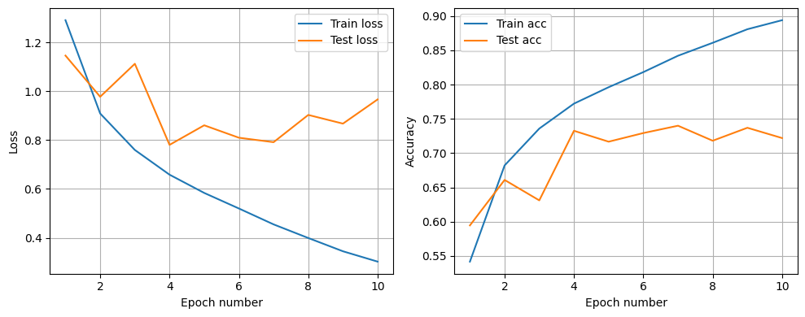

- **Residual blocks.** `F(x) + x` only works if input and output shapes match. I implemented the block and trained a small ResNet.

```mermaid
flowchart LR
    x((x)) --> C1[Conv + BN + ReLU] --> C2[Conv + BN]
    x -- skip connection --> P(("+"))
    C2 --> P --> R[ReLU] --> y((F(x)+x))
```

- **A real debugging lesson.** My first ResNet trained badly (about 54% train / 47% test). I suspected a `Softmax` placed before `CrossEntropyLoss`, which already applies log-softmax and expects raw logits. After I removed it, training accuracy reached 95.2%, but test accuracy was only 53.0%. That is a large overfitting gap, not underfitting.
- `model.train()` vs `model.eval()` changes how Dropout and BatchNorm behave.

### What I gained
Hands-on PyTorch for building, training and visualizing classifiers; the habit of checking shapes; and an eye for overfitting in a curve.

---

## Week 2: GPU computing on HPC

**Files:** `gpu_tensor_demo.py`, `IDLCV_Exercise_2_1_HPC.pdf`, `project2/jobscript.sh`

### What I learned
- Check CUDA, move a tensor with `.to(device)`, and save a **CPU copy** (`x_gpu.cpu()`) so the file loads on other machines.
- Write an LSF job script that requests a GPU, CPU cores, memory and a wall-time limit, loads a Python module and activates a virtual environment.

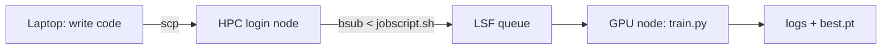

### What I gained
I can run training off my laptop. I did not save job output for this exercise, so I only claim the scripts, not a finished run.

---

## Project 1: Hotdog vs. not-hotdog

**Notebooks:** `project1/IDLCV_Project_1_hotdog.ipynb` (mine), `project1/IDLCV_Project_1_hotdog_v1.ipynb` (team) · **Brief:** `Project_1_hotdog.pdf`
**Data:** 2,047 training and 1,862 test images, two classes. The "not hotdog" class includes food, people, pets and furniture, so many negatives look like food.

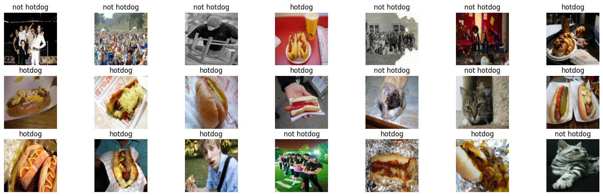

### What I learned
1. **Baseline.** A 3-stage CNN with Kaiming init learns the training set fast (train accuracy near 96%) but test accuracy stalls near 76%, which is a classic overfitting gap.

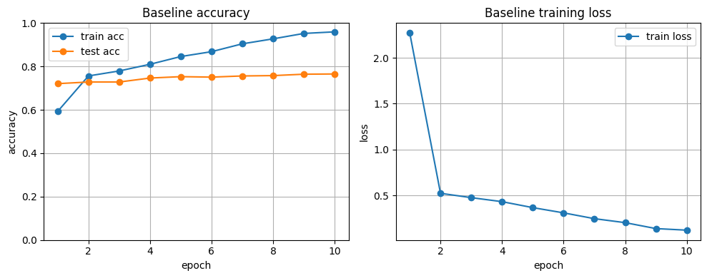

2. **Resizing is a design choice.** Squishing keeps the whole image but distorts it; a center crop keeps proportions but can cut off the subject. On this setup both ended at 74.0% test accuracy.

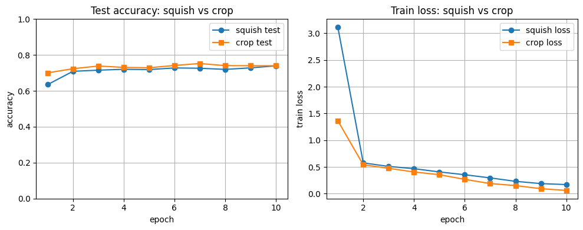

3. **Transfer learning is a big jump on small data.** Fine-tuning an ImageNet-pretrained ResNet-18 (ImageNet normalization, augmentation, lower learning rate) reached **90.8%** in 5 epochs.

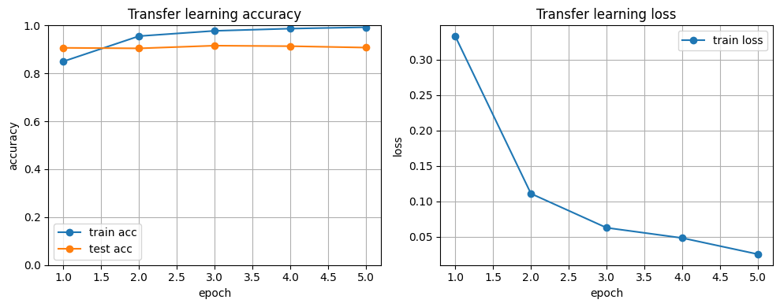

4. **Pretrained models need ImageNet normalization**, because their weights were learned on inputs scaled that way.

### The team's full ladder (team notebook)

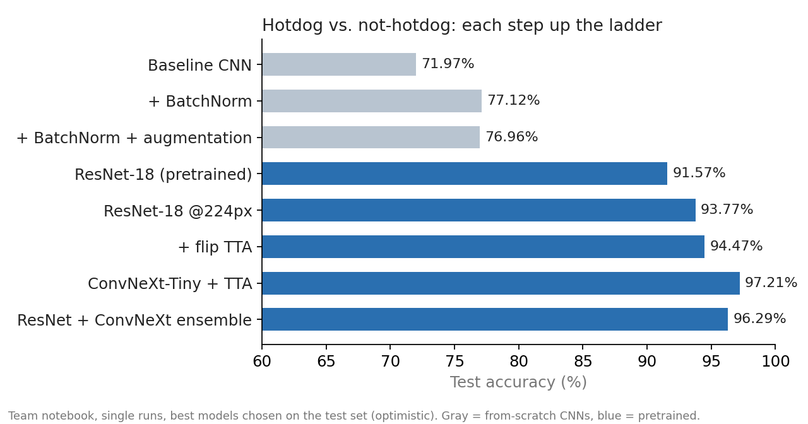

BatchNorm helped the from-scratch CNN, and augmentation did not help further in that run. Pretraining mattered most. A stronger backbone (ConvNeXt-Tiny) plus test-time augmentation (TTA) gave the best score.

### What I gained
A complete experiment loop: baseline, controlled comparison, transfer learning, and honest reporting. One caveat is that the best epoch is chosen on test data, so the top numbers are optimistic. A proper validation split and several seeds would fix that.

---

## Project 2: Video action classification

**Code:** `project2/` (`models.py`, `datasets.py`, `train.py`, `eval.py`, `jobscript.sh`, report section in `sec/3_method.tex`) · **Brief:** `Project_2_VideoClassification.pdf`
**Task:** classify 10 UCF actions from a clip of 10 frames.

### What I learned
The core question is **where in the network do you combine time?**

```mermaid
flowchart TB
    subgraph PF[Per-frame: train on single frames, average logits at test]
      f1[frame] --> c1[2D CNN] --> l1[logits] --> m1[mean over frames]
    end
    subgraph LF[Late fusion: 2D CNN per frame, fuse features]
      f2[T frames] --> c2[shared 2D CNN] --> a2[concat features] --> h2[classifier]
    end
    subgraph EF[Early fusion: stack frames as channels]
      f3[T frames → C×T channels] --> c3[2D CNN with adapted first layer] --> h3[classifier]
    end
    subgraph D3[3D CNN: convolve over time too]
      f4[clip C×T×H×W] --> c4[R3D-18] --> h4[classifier]
    end
    subgraph TS[Two-stream: RGB stream + optical-flow stream]
      r5[RGB clip] --> s1[late-fusion net] --> avg[average logits]
      o5[flow clip] --> s2[late-fusion net] --> avg
    end
```

- **Early fusion** needs the first conv layer changed to take `C×T` channels. The pretrained weights are repeated and scaled to fit.
- **Two-stream:** RGB and optical flow (precomputed with RAFT) must share the *same* crop and flip, otherwise the two streams no longer line up.
- **Data leakage.** UCF clips from the same video group (`_gNN`) can land in both train and validation, which inflates validation accuracy. We switched to a leakage-free split (500 / 120 / 120 videos).
- **Tensor shapes in practice.** `[B, C, T, H, W]` ↔ `[B·T, C, H, W]` via `permute` and `reshape`, which I annotated in the code.

### Results (leakage-free split, report section)
| Model | Validation | Test |
|---|---|---|
| RGB late fusion | 62.5% (best) | n/a |
| Dual-stream (RGB + flow) | 80.0% (best) | 77.5% |

The two runs used different training setups, so the gain cannot be credited to optical flow alone. Results for the other models are not saved in this folder (`runs/` is empty).

### What I gained
Experience with video as `[B, C, T, H, W]` tensors, with fusion architectures, with custom datasets and scripts that run on a cluster, and with spotting leakage before trusting a number.

---

## Skills summary

- **Languages / tools:** Python, shell, LaTeX; PyTorch, torchvision, NumPy, Matplotlib; Jupyter, Git, LSF/HPC, Apple MPS
- **Methods:** MLP, CNN, ResNet, BatchNorm, dropout, augmentation, SGD / Adam / AdamW, Kaiming init, transfer learning, TTA, 2D/3D video models, optical flow
- **Habits:** compare one change at a time, read train-vs-test curves, distrust numbers chosen on the test set, check for leakage

## Still to fill in
- My exact role in Project 1's team notebook and in Project 2 (the folder cannot show who wrote what).
- One thing to rerun: the saved Project 1 baseline once got stuck at 51.9% test accuracy, which conflicts with the 76.5% curve above. Rerun from the top before quoting the BatchNorm comparison.
- Save `history.json` and `eval.py` outputs for all five Project 2 models.
- Week 1 gaps: t-SNE/PCA, the second augmentation, and the saved SGD-vs-Adam plot.
